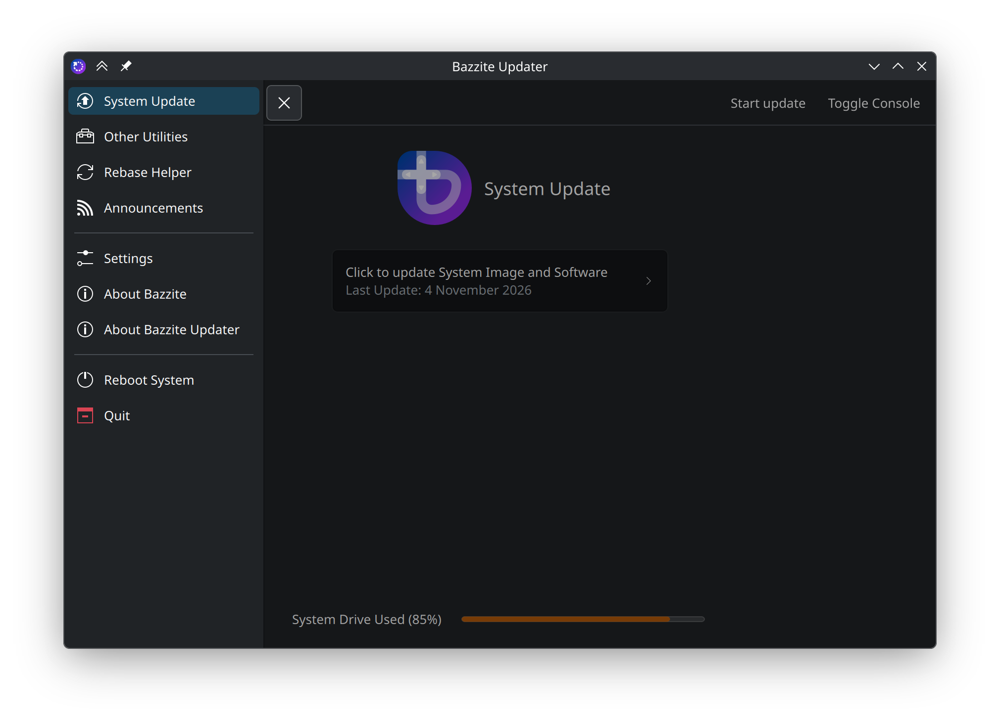

<h1>Bazzite Updater</h1>

<h2 align="center">A Graphical Frontend for the updating and rebasing tools used by Bazzite, configurable for any Linux distro!</h2>



<h1 align="center">Features</h1>

<p>This is a convenient, easy-to-use interface for updating your Linux system. While primarily designed for Bazzite, it has been designed so that it can be easily integrated into any linux distro that meets its requirements. Feel free to ask if you are interested in implementing it!</p>

- Simple and powerful
- Full support for all input types (keyboard/mouse, controller, touchscreen)

<br>

<h1 align="center">Icons</h1>

<p>The custom icons used by this app come from Bazzite.</p>

- https://github.com/ublue-os/bazzite/blob/main/system_files/desktop/shared/usr/share/ublue-os/bazzite/update.svg
- https://github.com/ublue-os/bazzite/blob/main/system_files/desktop/shared/usr/share/ublue-os/bazzite/logo.svg

<br>

<h1 align="center">Other Linux Distributions</h1>

<p>If you are a developer that wants to ship Bazzite Updater for your own distribution, I would be happy to help make that happen!</p>

<br>

<h1 align="center">Requirements</h1>

By default, this interface is configured to use bazzite's `uupd` system service for updating and `bazzite-rollback-helper` for rolling back updates. If you do not use these systems, you will need to edit `/etc/bazzite-updater/config.ini` to match your systems.

- This is not currently tested with packages older than the latest within Fedora and Arch linux.

<br>

<h1 align="center">Where to Install the Latest Release</h1>

The app is available in [Terra](https://docs.terrapkg.com/usage/installing/). Once the installation instructions are met, the package will be available as `bazzite-updater`.

```bash
sudo dnf install bazzite-updater
```

It is also posted to the github releases.

- https://github.com/rfrench3/bazzite_updater/releases

<br>

<h1 align="center">Configuration</h1>

In `/etc/bazzite-updater`, edit `config.ini` to change your update/rollback commands and edit `KAboutData_OS.json` (if desired) to match your Linux distro. Here is an example config.ini for Arch Linux:

```config.ini
[Commands]
systemUpdateCommand=pkexec pacman -Syu
systemRollbackCommand=
```

If you leave systemRollbackCommand blank (but still present!), it will hide that portion of the UI.

<p>Preferences that only affect the interface, like the reboot reminder shown on exit, are in the app's <b>Settings</b> page and get stored in <code>~/.config/bazzite-updaterrc</code>. Commands are never read from the home directory.</p>

<br>

<h1 align="center">License</h1>

<p>GPL-2.0-or-later. See LICENSES for details.</p>

<br>

<h1 align="center">Developer Instructions</h1>

I develop this project in a devcontainer with Zed and test it on bazzite by building it in a fedora distrobox and running on host. A justfile is present for specific scripts, which can be easily run using `just`.

```bash
# enter your fedora distrobox that has the right dependencies
just build-host
# run-host should work in the distrobox and on the host
just run-host
```
